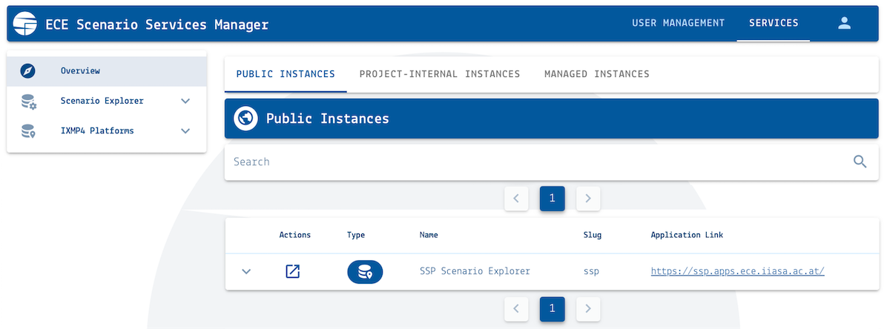

.. _scenario-databases:

Scenario databases hosted by IIASA
==================================

The *Energy, Climate and Environment* program (ECE) at IIASA is hosting many databases
for the community to facilitate scenario analysis, model comparison and dissemination
of project results.

Types of *Scenario Explorer*
----------------------------

*Scenario Apps* and **ixmp4** instances (2024-)
^^^^^^^^^^^^^^^^^^^^^^^^^^^^^^^^^^^^^^^^^^^^^^^

New *Scenario Explorer* instances use the *ScSe Apps infrastructure* and the **ixmp4**
package as a database backend.

Legacy *Scenario Explorer* instances (2018-2024)
^^^^^^^^^^^^^^^^^^^^^^^^^^^^^^^^^^^^^^^^^^^^^^^^

The previous generation of *Scenario Explorer* databases was developed in 2018
for the IPCC's *Special Report on Global Warming of 1.5°C* (SR15) and used for projects
that started between 2018 and 2024.

Legacy *Web Apps* (2008-2018)
^^^^^^^^^^^^^^^^^^^^^^^^^^^^^

The first generation of web databases and user interfaces was developed and used
for numerous projects including IPCC AR5 until 2018.

Access and permission management
--------------------------------

There are public and project-internal (private) database instances or **platforms**.
Access to project-internal platforms is managed via the `Scenario Services Manager`_.
There, you can see all public and private database instances to which you have access,
including your view/submit/edit permissions, in the *Services* tab of the manager.

   Screenshot of the "Overview" page of the `Scenario Services Manager`_

.. tip::

    Read the User Guide on :ref:`user-account` for more information.

.. _`Scenario Services Manager`: https://manager.ece.iiasa.ac.at

Model registration
------------------

To participate in a model comparison project using the IIASA scenario database infrastructure,
you have to "register" your model.

.. tip::

    Read the User Guide on :ref:`model-registration` for more information.

Scenario version management
---------------------------

When a modeling team submits a scenario (a.k.a. "run") to an IIASA database instance
where a run with that model-scenario combination already exists in the database, the new
submission will be saved as a new version of that run.
The **version number** is incremented automatically and the new version will be
automatically set as **default version** for that model-scenario name.

To select other (non-default) versions, you can use the "Switch to Advanced View" button
in the scenario-selection tab of an IIASA Scenario Explorer or you can use the
:code:`default_only=False` option of the function :func:`pyam.read_iiasa()`.

.. _scenario-processing:

Scenario processing
-------------------

When submitting a scenario (a.k.a. "run") to an IIASA database instance, the server
executes a scenario-processing workflow including *region-aggregation* and *scenario
validation* prior to saving the scenario to the database. The processing uses the
**nomenclature** package (`read the docs <https://nomenclature-iamc.readthedocs.io>`_).

The region-aggregation and validation is configured via a project-specific GitHub_
repository, usually named `https://github.com/iiasa/<project>-workflow`_. Please contact
the respective project managers or the Scenario Services team if you need to have
access.

You can also run the project workflow locally (on your computer) before submission to
an IIASA database instance, to make sure that the validation and processing works.

The workflow for processing files uploaded via the IIASA Scenario Explorer is
implemented in a modular fashion. It is possible to execute programs, code and tools
developed by (non-IIASA) research partners as part of the processing workflow
if the tool follows the :ref:`processing-requirements`.

.. tip::

    Read the User Guide on :ref:`local-processing` for more information.

.. _GitHub: https://www.github.com

.. _`https://github.com/iiasa/<project>-workflow`: https://github.com/iiasa

.. _database-api:

Database API
------------

You can query scenario data from an IIASA database instance directly via Python or R.

.. tio::

    Read the User Guide for :ref:`query-iiasa-databases` for more information.
