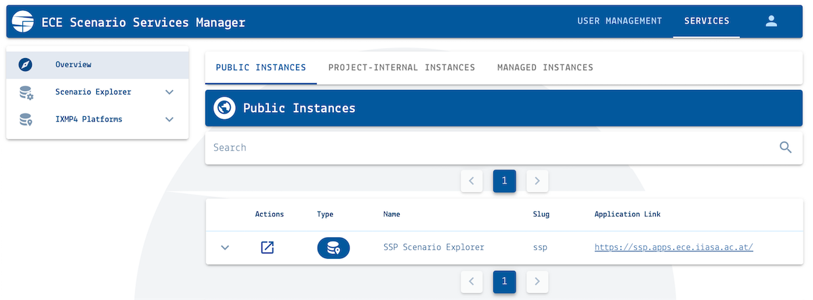
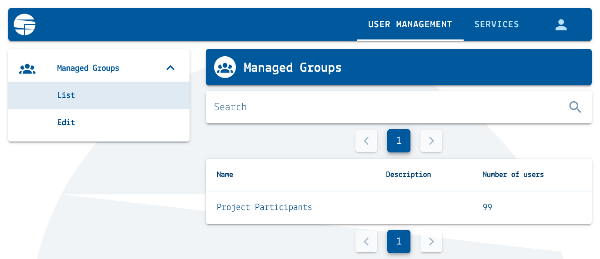

.. _manager:

Access and permission management
================================

There are public and project-internal (private) database instances or **platforms**.
Access to project-internal platforms is managed via the `Scenario Services Manager`_.

.. _`user_registration`:

Registering in a Scenario App
-----------------------------

To register a new user account, go to https://manager.ece.iiasa.ac.at/register.
Once you click **Register**, a message will be sent to the registered e-mail address
to validate the account.

.. _`scenario_app_access`:

Accessing a Scenario App
------------------------

In order to have access to a project-internal app, users must be registered
in the respective accessor group. Gated apps are accessible to any user logged into
their Scenario Services account. Public apps are accessible to any person by default.

Access permission for project-specific Scenario Apps is configured in the Manager.
You can see all public and private database instances to which you have access,
including your view permissions, in the *Services* tab of the manager.

   Screenshot of the "Overview" page of the `Scenario Services Manager`_

.. _`Scenario Services Manager`: https://manager.ece.iiasa.ac.at

To participate in a project and gain access to an instance, please register an
account and send the username to an administrator from the IIASA Scenario Services
team and the appropriate project manager(s).
If you require upload permission, see the next step.

.. _`upload_permissions`:

Upload Permissions for a Scenario App
-------------------------------------

In order to upload data to the Scenario Explorer, the user must be registered in
the appropriate modeler group(s).

To have submit permission, please contact an administrator from the IIASA
Scenario Services team, or the appropriate contact person in the project,
specifying the model name(s) and version(s) to be uploaded (e.g.:
**Model-Name v1.0**).

You can see all public and private database instances to which you can upload data
in the *Services* tab of the manager.
You can also confirm the model(s) you can upload in the Scenario App, in the
**Scenario Submission** page, see :ref:`scenario_submission`.

.. _group_manager:

Managing User Permissions
-------------------------

Users can also be **Group Managers**, allowing them to manage user membership
in a group.
After logging in to the Manager, group managers can see a **User Management** tab.

   A group manager can see and access the User Management tab in the Manager
   navigation menu.

In the **User Management** tab:
- Go to **Managed Groups > List** to see all the groups you manage.
- Go to **Managed Groups > Edit** to see all users in a group, add, and remove users.

Both menus support text search.

To manage users in a group:
1. Select a group from the list or by searching.
   The group page will open in the **Info** tab.
2. Go to the **Members** tab to list all current users.
3. To add a user, go to the **Add User** section at the bottom of the page,
   input a username or e-mail, and click the Add User button.
4. To remove a user, search for its username or e-mail in the Current Members
   section at the top of the page, and the red trash bin icon next to their entry.

.. warning::

   There is no confirmation step before removing users from a group.
   Make sure you are certain about the user(s) you are removing before proceeding.
   To undo a removal, you must manually add the user again.
