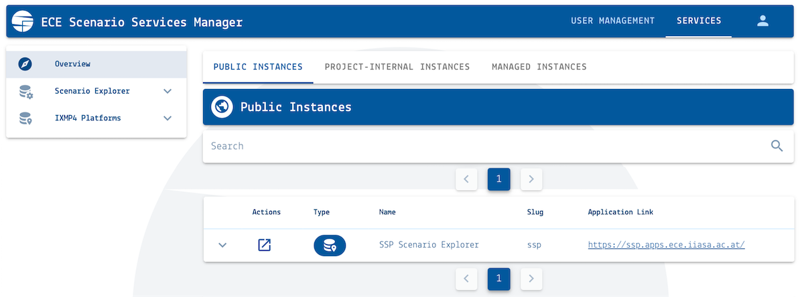
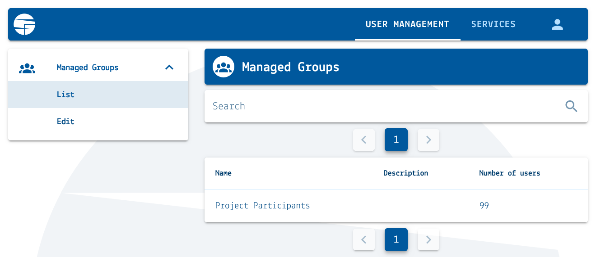

.. tip::

  This is the first step of the **Preparing Scenario Submissions** user guide.

  To learn how to prepare data for scenario submission, go to :ref:`model-registration`.

.. _user-account:

Access and permission management
================================

There are public and project-internal (private) database instances or **platforms**.
Access to project-internal platforms is managed via the `Scenario Services Manager`_.

.. _user-registration:

User registration
-----------------

To register a new user account, go to https://manager.ece.iiasa.ac.at/register.
Once you click **Register**, a message will be sent to the registered e-mail address
to validate the account.

.. _scenario-app-access:

Accessing a Scenario App
------------------------

In order to have access to a **pProject-internal app**, users must be registered
in the respective accessor group. **Gated apps** are accessible to any user if they are
logged in using their account. **Public apps** are accessible to all users and do not
require to log in.

Access permission for project-specific Scenario Apps is configured in the
`Scenario Services Manager`_. You can see all public and internal Scenario apps to which
you have access in the *Services* tab of the manager. This page also shows your
permissions to view/submit/edit scenarios for specific models.

   Screenshot of the "Overview" page of the `Scenario Services Manager`_

.. _`Scenario Services Manager`: https://manager.ece.iiasa.ac.at

To participate in a project and gain access to an instance, please register an
account and send the username to an administrator from the IIASA Scenario Services
team and/or the relevant project manager(s).
If you require upload permission, see the next step.

.. submission-permissions:

Submission permissions for a Scenario App
------------------------------------------

In order to submit scenarios (i.e., upload a file) to a Scenario Explorer app, the user
must be added to the appropriate modeler group(s).

To have submit permission, please contact an administrator from the IIASA
Scenario Services team or the appropriate contact person in the project,
specifying the model name(s) and version(s) to be uploaded (e.g.: **Model-Name v1.0**).

.. _group-manager:

Managing user permissions
-------------------------

Project coordinators or modelling team leads can be assigned as **Group Managers**,
allowing them to add users to a group or remove them, thereby giving/revoling access to
project-internal apps or assigning view/submit/edit permissions for a model.

   A group manager can see and access the User Management tab in the Manager
   navigation menu.

In the `Scenario Services Manager`_, group managers will see a **User Management** tab.

- Go to **Managed Groups > List** to see all the groups you manage.

- Go to **Managed Groups > Edit** to see all users in a group and add/remove users.

Both menus support text search.

To manage users in a group:

1. Select a group from the list or by searching.
   The group page will open in the **Info** tab.
2. Go to the **Members** tab to list all current users.
3. To add a user, go to the **Add User** section at the bottom of the page,
   input a username or e-mail, and click the Add User button.
4. To remove a user, search for its username or e-mail in the Current Members
   section at the top of the page, and the red trash bin icon next to their entry.

.. warning::

   There is no confirmation step before removing users from a group.
   Make sure you are certain about the user(s) you are removing before proceeding.
   To undo a removal, you must manually add the user again.
