.. _data-explorer:

Data Explorer
=============

The Data Explorer allows you to visually explore scenario data in different
charts. With this tool, it is possible to:

- view data according to their original geographical resolution
- create, save, edit, and share workspaces
- visualise data in line 
- customise the chart visualizations with 

The Map Explorer can be broken down into three main components:

- the **data selection menu**, comprising the top section of the page
- the **workspaces toolbar**, above the data selection menu
- the **visualization menu**, located in the bottom section of the page

Data Selection
--------------

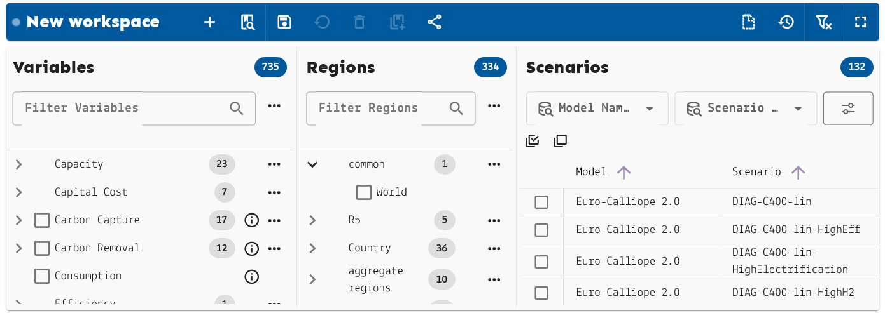

   The Data Selection menu.

The data selection has three sections, where you select |region| regions,
|variable| variables, and |model| |scenario| model/scenario combinations.
Available selections are updated when each data filter is selected to only include
combinations for which data is available.

Each dimension can be searched using their text search bar. Regions and variables
are displayed in a nested, hierarchical tree structure that can be navigating by
clicking each level to reveal deeper elements. Some entries display an |info-circle|
information icon which shows a description on hover.
When some selection is made, it's possible to expand the bottom section to reveal
all the active filters, which can be removed individually. Each dimension's
selection can also be reset by clicking the |clear-filter| **Unselect All**
button.

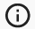

The **Show variables, regions and scenarios where no data exists given the applied filters**
disables this automatic filter.
The |show-older-versions| **Show other versions of scenarios with the same model/scenario-name
combination** shows older versions of data that was uploaded for the model/scenario
pairs indexed in the scenario database.
The |clear-filter| **Clear Selection and Filters** button resets the data selection
to a blank slate.

.. tip::

   To understand how data versioning based off model/scenario combinations works
   in Scenario Apps, see *I didn't upload all of my regions/variables in my
   original submission. Can I upload only the missing data?* in the :ref:`faq`.

   

.. _workspaces:

Data workspaces
^^^^^^^^^^^^^^^

A **workspace** is a selection of data and chart visualization options.
Workspaces are convenient environments to experiment with different data selections
and chart options, to later share with other users, and to download data slices.

To create a workspace, simply make the data selection you wish to save.
Then, click the **"New workspace"** name to rename the workspace and optionally,
add a longer description. Click **Save Workspace** to confirm.
To create a new workspace, different from the one you are currently working on,
click the |plus| **Create a new workspace** button. The current selection will be lost.

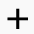

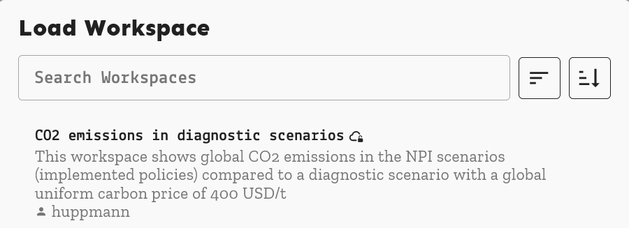

   The Load Workspace menu, listing a public workspace with its name and description.

To load an existing workspace, click the **Load Workspace** button. This will
open up the list of available workspaces (public workspaces and those visible to
the user, such as their own) that you can scroll or search by text, as well as
sort by name, owner, or date of last update, in ascending or descending order.

While editing a workspace, it's possible to reset it to its last saved status
with the **Reset Workspace** button.
To copy a workspace into a new workspace, click the **Copy Workspace** button.
A window will open to prompt you to name the new workspace, as well as optionally
write a description.
Sharing a workspace with the **Share Workspace** button copies the URL link of
the workspace to your clipboard, as indicated in the notification that pops up.
Users with access to the Scenario App can see the workspace you share.

To delete a workspace, click the **Delete Workspace** button. This will open a
confirmation window.

Data Visualization
------------------

Data can be represented in line charts, bar charts, and data tables.
The visualization is displayed on the left side of the visualization section.
The legend is displayed on the right side. You have the option to collapse the
legend by clicking the |hide-legend| **Hide Legend** button.

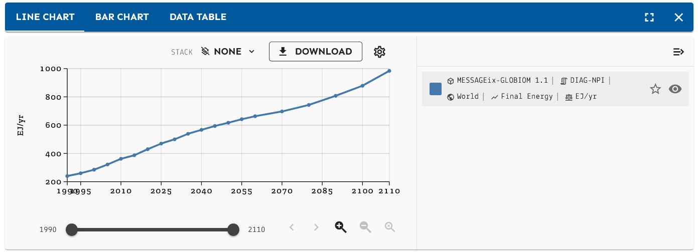

   The Line Chart data visualization.

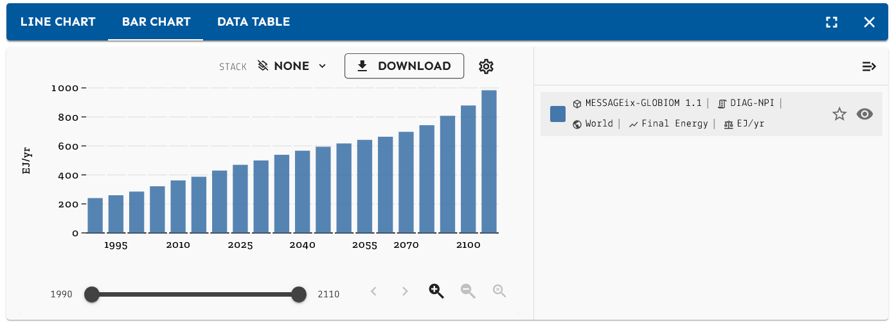

   The Bar Chart data visualization.

For subannual data (available for line charts and data tables), the X-axis
representing time will automatically adjust its scale in certain zoom levels
to represent that dimension accurately (e.g. hourly).

The time dimension can be adjusted with three buttons and a slider. Using the
|zoom-in| **Zoom In**, |zoom-out| **Zoom Out**, and |zoom-reset| **Reset Selection**,
you can quickly narrow down the time interval to observe.
Using the slider, you can expand, shrink, and shift the time range with greater
precision.
The |pan-left| **Pan Left** and |pan-right| **Pan Right** buttons navigate the time
window while keeping the range size consistent.

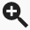

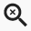

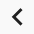

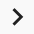

It's also possible to stack the line and bar charts. By default, the option selected
is |stack-none| **None**. The drop-down menu provides stacking by |stack-all|
**Variables & Regions**, |variable| **Variables**, or |region| **Regions**.

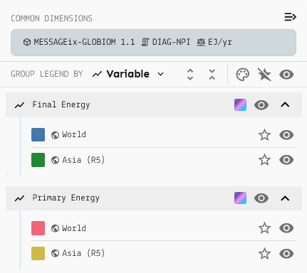

   The data visualization legend menu with multiple dimensions.

In the legend menu, you can access more advanced visualization options.
In the top section, you can see at a glance the dimensions common to all data
points selected with the filters.
Below that, you have grouping options. It's possible to keep the time series
ungrouped (|group-none| **None**), or group by |variable| **Variable**
or |region| **Region**.
Each time series or group of time series can be colored, highlighted, and hidden.
Highlighting time series keeps their color while dimming the remaining series.
Hiding time series removes them from the visualization entirely, but preserves
them in the data selection.

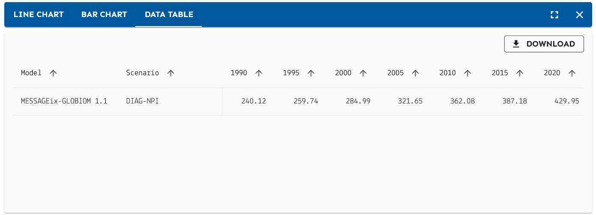

   The Table data visualization.

.. _downloading:

Downloading data
^^^^^^^^^^^^^^^^

In the chart panel, click the |download| **Download** button, and then select
the "Data CSV" option. This will start a download for the current data selection.

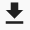

Advanced Data Selection
-----------------------

For additional options to select data, particularly for projects with many
model-scenario combinations, you can use **Advanced Data Selection**.
For this, click the |adv| button on the top left corner of the Scenarios panel.

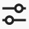

In this menu, you have two sections. The Filter panel allows you to:

- **Filter by Name:** select models and/or scenarios by typing the names and
  confirming the filter selection from a drop-down menu.

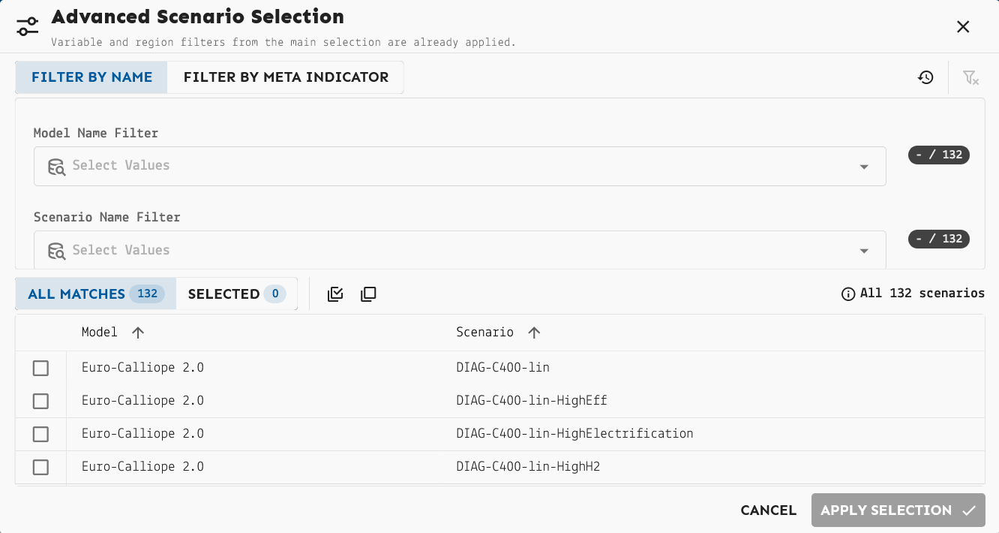

   The Filter by Name tab.

- **Filter by Meta-Indicator:** select meta-indicators and apply filters according
  to their values (value match, range selection, etc.).

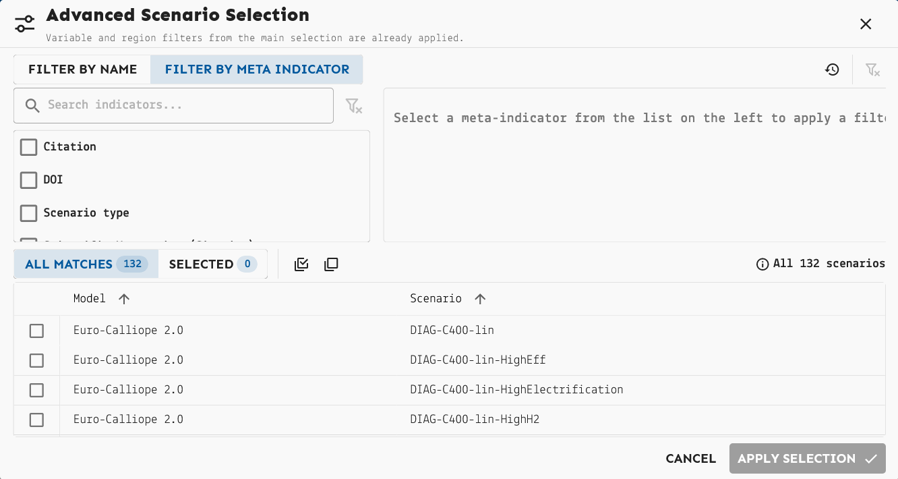

   The Filter by Meta-Indicator tab.

The Matches panel shows a list of the model-scenario combinations that match
the selected filters in the Filter panel. The **Select All Displayed** |select-all|
and |select-none| buttons conveniently add/remove all matches from the selection.

