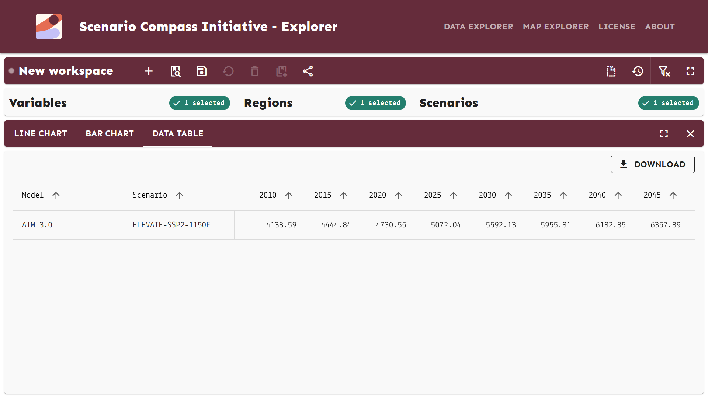

.. _data-explorer:

Data Explorer
=============

.. figure:: ../../_static/explorer-1.png
   :width: 600px
   :align: center

   The Data Selection menu.

.. figure:: ../../_static/explorer-2.png
   :width: 600px
   :align: center

   The Line Chart data visualization.

.. figure:: ../../_static/explorer-3.png
   :width: 600px
   :align: center

   The Bar Chart data visualization.

   The Table data visualization.

.. _downloading:

Downloading data
^^^^^^^^^^^^^^^^

In the chart panel, click the |download| **Download** button, and then select
the "Data CSV" option. This will start a download for the current data selection.

Advanced Data Selection
-----------------------

For additional options to select data, particularly for projects with many
model-scenario combinations, you can use **Advanced Data Selection**.
For this, click the |adv| button on the top left corner of the Scenarios panel.

In this menu, you have two sections:

- the Filter panel allows users to:

  - **Filter by Name:** select models and/or scenarios by typing the names and
    confirming the filter selection from a drop-down menu.
  - **Filter by Meta-Indicator:** select meta-indicators and apply filters according
    to their values (value match, range selection, etc.).

- the Matches panel shows a list of the model-scenario combinations that match
  the selected filters in the Filter panel. The **Select All Displayed** |select-all|
  and |select-none| buttons conveniently add/remove all matches from the selection.

