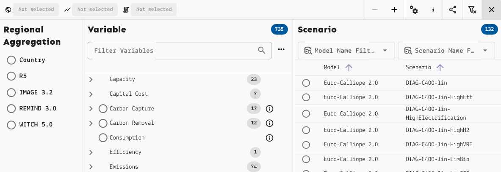
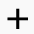
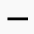
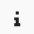
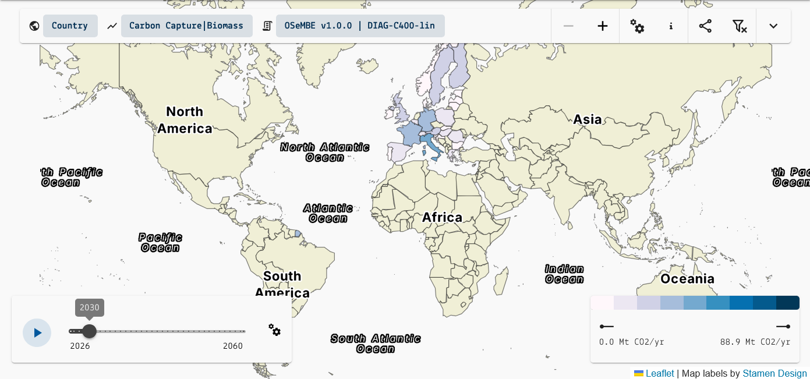
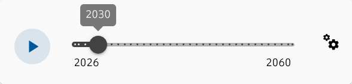
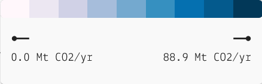

.. _map-explorer:

Map Explorer
============

The Map Explorer allows you to visually explore scenario data with the aid of
a map projection. With this tool, it is possible to:

- view data according to their original geographical resolution
- view data in aggregated form, calculated from the original resolution
- compare data across regions with choropleth mapping
- understand variable evolution over time with timeline progression

The Map Explorer can be broken down into four main components:

- the **data selection toolbar**, located in the top section of the page
- the **map visualization**, employing Natural Earth or Equal Earth datasets
- the **timeline progression**, located in the bottom left corner of the page
- the **choropleth legend**, located in the bottom right corner of the page

Data Selection
--------------

   The Map Explorer data selection toolbar.

The data selection toolbar expands to reveal a three-part menu where you select
one |region| region aggregation, one |variable| variable, and one |scenario| scenario.
Available selections are updated when each data filter is selected to only include
combinations for which data is available.
A reminder message will be displayed on top of the map view while the selection
is incomplete.

Unlike the Data Explorer, this interface doesn't select specific regions;
instead, you can select the region aggregation to apply to the world map.
These can be standard territories, like countries or continents, or model-specific
region definitions.

On the right section of the toolbar, there are the following buttons:

- |minus| |plus| **-/+** to zoom the map in/out
- |settings| **Visualiation Settings** to select number of data classes, color scheme,
  and color for missing values
- |info| **About this Map** to read more information on the geodata used for the
  Map Explorer
- |share| **Share Map** to copy the link to the current map view (and data selection)
  to share with other users with access to the Scenario App
- |clear-filter| **Clear Selection and Filters** to reset the map to a blank slate

.. tip::
    To learn more about region definitions, see :ref:`regions`.
    To learn more about region aggregation, see :ref:`model-mappings`.

Map Visualization
-----------------

   The Map Explorer data selection toolbar.

The map supports zooming out for a view of the entire world, and zooming in down
to a generally subnational scale.

Clicking on a region will pan the map to it and open up a detailed data chart
at the bottom of the page.
In the detailed chart view, it's possible to show/hide specific time series,
download the chart image and/or data, and toggle between seeing only the region
data and comparing with other regions.
Hovering over a data point reveals all the information pertaining to it.

   Timeline slider.

The timeline slider can be moved manually or set to play automatically.
It will show the evolution of the chosen variable over time.
The |settings| **Slider settings** allows changing the speed of the animation.

   Choropleth legend.

The choropleth legend shows the color scheme assigned to the map. Hovering over
each color will reveal the interval of values it represents.
