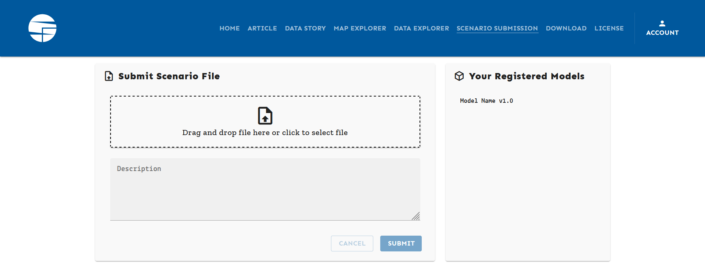

.. _scenario-submission:

Scenario Submission
===================

Submitting scenario data
------------------------

To upload data through the Scenario App, select the **Scenario Submission** page
in the navigation bar. If you have not yet logged in to your Scenario Services
account, the **Log In** window will pop up to prompt you to enter your credentials.

   
   The Scenario Submission page. 

The **Submit Scenario File** menu on the left side displays a space to drag
and drop or click to select the file to upload, and an optional text
description for the upload job log.

The **Your Registered Models** on the right side lists the model names and
versions for which upload permissions are set for the current user.

Once an upload job starts, it will be displayed in the **Submissions List**.
Here, the filename, upload date/time, file size, and user are listed for
each job, as well as the processing time and upload status (success or
failure).

*Submissions list screenshot*

For each job, the user can download the file, restart the job, and open the
**Job details** window with the full log output and error summary.

For common upload errors with short messages, a red warning box with the
error text will be displayed in the **Error Summary** (e.g.:
``Forbidden: You are missing submit permissions for: ['Model Name v1.0'].``).

If no error summary is displayed, the full error can be identified in the
log.

Scenario version management
---------------------------

When submitting a scenario (a.k.a. "run") to an IIASA database instance, the server
executes a scenario-processing workflow including *region-aggregation* and *scenario
validation* prior to saving the scenario to the database. The processing uses the
**nomenclature** package (`read the docs <https://nomenclature-iamc.readthedocs.io>`_).

The region-aggregation and validation is configured via a project-specific GitHub
repository, usually named `https://github.com/iiasa/<project>-workflow`_. Please contact
the respective project managers or the Scenario Services team if you need access.

You can also run the project workflow locally (on your computer) before submission to
an IIASA database instance, to make sure that the validation and processing works.
See :ref:`local-workflow` for more information.
 
The workflow for processing files uploaded via the IIASA Scenario Explorer is
implemented in a modular fashion. It is possible to execute programs, code and tools
developed by (non-IIASA) research partners as part of the processing workflow
if the tool follows the :ref:`processing-requirements`.

.. _`https://github.com/iiasa/<project>-workflow`: https://github.com/iiasa

.. _`scenario-submission-errors`:

Common scenario submission errors
---------------------------------

The following is a list of common scenario submission errors:

* ``Forbidden: You are missing submit permissions for: [...]``

   **Reason:** The user does not have permission to upload data for the
   model(s) listed in the error message.

   **Fix:** If the user is not meant to submit scenarios for the model(s), remove
   the corresponding rows of data. If the user is meant to submit scenarios for
   the model(s), compare the **Your Registered Models** list to the error
   message and 1) check the spelling, including upper/lowercase, extra
   whitespace, etc., 2) check the model version number. If the error persists
   or no such model is listed in the registered models, please contact a
   project manager or IIASA administrator to add the missing permissions.

* ``nomenclature.exceptions.WrongUnitError: The following variables(s) are reported in the wrong unit: [...]``

   **Reason:** The data contains variables reported with the wrong unit of
   measurement.

   **Fix:** Replace the wrong (``found``) unit of measurement for the correct
   one (**expected**). If the expected unit is incorrect, please contact a
   project manager or IIASA administrator.

* ``nomenclature.exceptions.UnknownVariableError: The following variable(s) are not defined in the variable codelist: [...]``

   **Reason:** The data contains variables not allowed for the project.

   **Fix:** If the variables are not meant to be uploaded, remove the
   corresponding rows of data. If the variables are meant to be uploaded,
   please refer to the template file in the full log output, compare the
   listed variables with the template's and check the spelling, including
   upper/lowercase, extra whitespace, etc. If the variables are listed in the
   template with a different naming convention, rename the variables in the
   upload data or please contact a project manager or IIASA administrator.

* ``nomenclature.exceptions.UnknownRegionError: The following region(s) are not defined in the region codelist: [...]``

   **Reason:** The data contains regions not allowed for the project.

   **Fix:** If the regions are not meant to be uploaded, remove the
   corresponding rows of data. If the regions are meant to be uploaded,
   please refer to the template file in the full log output, compare the
   listed regions with the template's and check the spelling, including
   upper/lowercase, extra whitespace, etc. If the regions are listed in the
   template with a different naming convention, rename the regions in the
   data to be uploaded or please contact a project manager or IIASA administrator.
